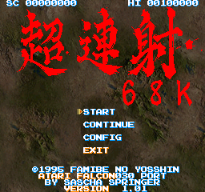
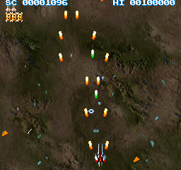

# Cho Ren Sha 68k for the Atari Falcon030

Cho Ren Sha 68k, the X68000 vertical shooter (c) 1995 by Famibe No Yosshin, ported to the Atari Falcon030.  The
game's whole 68000 program, as a disassembly (`sources/sz2.s`), is assembled for the 68030 and runs natively; a small
Atari layer stands in for the X68000's hardware and system calls.  Sprites are compiled to 68030 code, and the
Falcon's DSP works out which background pixels have to be restored in each frame.

**Since 2026 this project is AI-assisted.**  The original port (2014-2015) was written by hand; the changes from 2026
on were made with AI coding agents (Claude Code) under the author's direction, as the commit history shows.

| | |
|:-:|:-:|
|  |  |

Screenshots from Hatari (2026-11-08), at the Falcon's 256 x 240 resolution.

## Status

A beta.  The game runs, but it has not been played through, and the changes made in 2026 (the DSP restore runs, the
256 x 240 modes, the display-line throttle) have not been run on a real Falcon yet.  Checked in Hatari 2.6.1-devel
(Falcon030 at 16 MHz, TOS 4.04, 14 MB, emulated DSP): the info screen, the title menu and the attract mode on an RGB
monitor (50 Hz) and on a VGA monitor (60 Hz).

In the attract mode in Hatari the game logic runs every VBL, and the picture keeps up with about 91% of the frames on
RGB (about 45 pictures a second) and 87% on VGA (about 52).  These are Hatari figures, not measurements on real
hardware.

Known limitations:

- No music.  Sound effects are played as DMA samples (not checked for the release).
- The background does not scroll (`update_background` in `sources/atari/graphics.s`).
- The bottom 16 lines of the X68000's 256-line picture are not shown.

The same source still builds the original X68000 program: the build compares the result with the original `SZ2.X`
byte for byte.  An Amiga port is not started (`sources/amiga/amiga.s` only prints a message).

## Download

[Release 0.1](https://github.com/AnimaInCorpore/chorensha/releases/tag/v0.1) (2026-11-08): `chorensha-0.1.zip` holds
`SZ2.TOS`, its DSP program `DSPRITE.LOD`, the game's data folders and a README.TXT with the controls.  The sources
may be newer than the release.

## Running

Requirements: an Atari Falcon030 with 14 MB of RAM (4 MB is not enough: the program needs about 8.6 MB, of which about
2.1 MB must be ST-RAM), and an RGB monitor or TV (256 x 240, 50 Hz) or a VGA monitor (256 x 240 line-doubled, 60 Hz).
The program's header lets TOS load it into TT-RAM if there is some (not tested).

Start `SZ2.TOS` from the desktop, from a hard disk or a GEMDOS drive.  `DSPRITE.LOD` and the folders `BGM_DAT`,
`ETC_DAT`, `PCM_DAT` and `XSP_DAT` must be in the same folder.  The info screen waits for a key; the title menu's EXIT
returns to the desktop.

| Input | |
|---|---|
| Keyboard | cursor keys move, Left Shift button 1, Control button 2 |
| Joystick | joystick port 1 moves; the right mouse button is button 2 |
| Jaguar pad | in the enhanced joystick port A: D-pad moves, B button 1, A button 2 |

## Building from the sources

Three scripts build the X68000 program and the Falcon port, run from the repository's root:

```sh
sh build_mac.sh     # macOS
sh build.sh         # Linux
sh build_win.sh     # Windows (a POSIX shell such as Git Bash)
```

- **68000/68030 code:** vasm and vlink, for each system in `tools/` (`vasmm68k_mot*`, `vlink*`).
- **DSP code:** `build_mac.sh` uses the native rebuild of Motorola's assembler, ASM56000, from a checkout next to this
  one (`make asm56000 cldlod` there, or set `DSP_TOOLS` to its build directory).  `build.sh` and `build_win.sh` run
  Motorola's original `tools/asm56000.exe` and `tools/cldlod.exe`.  TOS loads `dsprite.lod` only with CRLF line
  endings (an LF file crashes `Dsp_LoadProg`), so `build_mac.sh` converts the native output.
- **X68000 program:** linked with `human68k-ld` and `human68k-objcopy` (Windows programs in `tools/`; the macOS script
  runs them with wine, the Linux script expects them on the path).  `SZ2.X` is copied to
  `binaries/x68000/CH68_101_B/` and compared with `binaries/x68000/sz2.hex`.

The Falcon results are `binaries/atari/sz2.tos` (`sz2_dbg.tos` keeps the symbols) and `binaries/atari/dsprite.lod`;
together with the `..._DAT` folders in `binaries/atari/` they make the release.

### Testing in Hatari

Hatari did not start the program from its path in our runs; an AUTO folder does:

```sh
mkdir -p drive/AUTO
cp binaries/atari/sz2.tos drive/AUTO/SZ2.PRG
cp binaries/atari/dsprite.lod drive/DSPRITE.LOD
cp -R binaries/atari/*_DAT drive/
hatari --machine falcon --dsp emu --memsize 14 --tos tos404.img \
  --cpu-exact true --compatible true --monitor rgb --harddrive drive
```

Use `--monitor vga` for the VGA mode.  `--machine falcon` must come before the other machine options.  For timing,
use a Hatari whose DSP runs at the real speed: Homebrew's Hatari 2.6.1 runs the DSP at about twice its speed (see
F030Arcade's notes on its pinned Hatari build).

## How it works

- **The game** (`sources/sz2.s`) is a disassembly of `SZ2.X`.  The comments keep the original addresses and opcodes,
  and about twenty `ifd __ATARI__` blocks patch the places that touch the hardware directly: interrupt vectors, the
  VBL wait, text drawing, and the sprite output, which goes to the Falcon renderer instead of the X68000's sprite
  hardware.  `sources/sincos.dat` holds sine/cosine tables for the Atari build.
- **The X68000 layer** (`sources/atari/emulator.s`, `mem_map.s`): the game's DOS calls (Line-F) and IOCS calls
  (`trap #15`: joystick, palette, ADPCM) are answered with TOS calls and the Falcon's hardware; the X68000's text VRAM,
  CRTC, palette and sprite registers are ordinary RAM.
- **The renderer** (`sources/atari/graphics.s`): a double-buffered 256 x 240 true-colour screen.  All 1,885 sprite
  patterns are compiled at load time into 68030 code, in four flips each; a sprite draws itself with its colours in
  registers.  The text layer uses compiled characters as well.
- **The DSP** (`sources/atari/dsprite.asm`) keeps masks of the sprites of the last two frames.  The pixels that were
  covered before but are not now are sent to the 68030 as runs (offset and jump displacement), and the 68030 copies
  those pixels from the background image with unrolled longword moves.
- **Scheduling:** the renderer runs in the VBL handler as a chain of stages and yields at display line 170 (counted by
  Timer B, one or two events a line, detected each frame), so that the game gets the rest of the frame.
- **The machine** (`machine.s`): the Videl modes and the interrupt vectors; `input.s` the IKBD (keyboard, joystick,
  mouse); `audio.s` the sample buffer.  `sources/atari/adpcm.s` is a separate tool that turned the X68000's ADPCM
  sound effects into the samples in `PCM_DAT`.

## Layout

    sources/sz2.s          the game: disassembly of SZ2.X (X68000) with the Atari patches
    sources/sincos.dat     sine/cosine tables for the Atari build
    sources/atari/         the Falcon port: main.s (start), emulator.s (DOS/IOCS calls, VBL), mem_map.s (X68000
                           memory areas), graphics.s (renderer), dsprite.asm (DSP program), machine.s (Videl, MFP),
                           input.s (IKBD), audio.s, adpcm.s (ADPCM to sample tool), ioequ.inc (DSP equates)
    sources/x68000/        mem_map.s for the X68000 build
    sources/XSP200_2/      the XSP 2.00 sprite library the game uses (sources and Japanese documentation)
    sources/amiga/         the start of an Amiga port
    binaries/atari/        the game's data for the Falcon (BGM_DAT, ETC_DAT, PCM_DAT, XSP_DAT); the build writes
                           sz2.tos, sz2_dbg.tos and dsprite.lod here (not in git)
    binaries/amiga/        the game's data for an Amiga port
    binaries/x68000/       the X68000 disks (CH68_101_A: system, CH68_101_B: game) and the original SZ2.X as hex
    docs/                  the X68000 I/O map (_IOMAP.MAN.txt) and the README's screenshots
    tools/                 vasm, vlink, Motorola's DSP56000 assembler and cldlod, human68k-ld and -objcopy
    build.sh build_mac.sh build_win.sh     the build scripts (Linux, macOS, Windows)

## Copyright

Cho Ren Sha 68k and the XSP sprite library are by Famibe No Yosshin (1995 and 1997).  The game's code (in
`sources/sz2.s`), its graphics, sound and data (`binaries/*/..._DAT`) and the screenshots belong to their author.
The X68000 system files on the disk in `binaries/x68000/CH68_101_A` belong to their owners, and the tools in `tools/`
to theirs (vasm and vlink: Volker Barthelmann and Frank Wille; the DSP56000 assembler: Motorola).  The Atari port's
own code is by Sascha Springer.  This repository has no license file yet.
