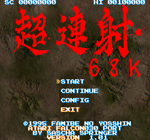
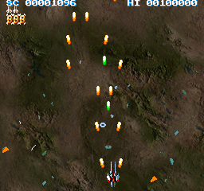

# Cho Ren Sha 68k for the Atari Falcon030

Cho Ren Sha 68k, the X68000 vertical shooter (c) 1995 by Famibe No Yosshin, ported to the Atari Falcon030.  The
game's own 68000 program runs on the Falcon as it is; a small Atari layer stands in for the X68000's hardware, and
the Falcon's DSP helps with the drawing and plays the sound.

**Since 2026 this project is AI-assisted.**  The original port (2014-2015) was written by hand; the changes from 2026
on were made with AI coding agents (Claude Code) under the author's direction, as the commit history shows.

| | | |
|:-:|:-:|:-:|
|  |  | <a href="https://youtu.be/iYPEBJRyvHs"></a> |

Screenshots from Hatari (2026-11-08), at the Falcon's 256 x 240 resolution, and a
[video of the port running](https://youtu.be/iYPEBJRyvHs).

## Status

Beta 2.  The game runs, with music and sound, but it has not been played through, and none of this year's work has
been tried on a real Falcon.  It has been checked in the Hatari emulator (Falcon030, TOS 4.04, 14 MB, emulated DSP)
on both kinds of monitor.  In the attract demo the game itself keeps full speed, and the screen is redrawn for about
19 frames out of 20 over the stretch that was measured; an earlier and longer measurement gave about 4 out of 5.
Both are emulator figures, not measurements on real hardware.

What is still missing or unproven:

- The music and the sound effects are new in this release and have only been heard in the emulator.
- The background scrolls in one layer only, and not sideways.
- The bottom 16 lines of the X68000's picture are not shown.
- A 68030 is needed: the game does not run on a 68040 or on a CT60's 68060 (see [Running](#running)).

The same sources still build the original X68000 program, and the build compares it with the original byte for byte.
An Amiga port is not started.

## Download

[Release 0.2](https://github.com/AnimaInCorpore/chorensha/releases/tag/v0.2) (beta 2, 2026-11-17) holds the program,
its DSP program, the game's data and a README.TXT with the requirements and the controls.  New since
[release 0.1](https://github.com/AnimaInCorpore/chorensha/releases/tag/v0.1): the music and the sound effects through
the DSP, the scrolling background, and a renderer that keeps the CPU and the DSP working at the same time.  The
sources here may be newer than the release.

## Running

You need a Falcon030 with 14 MB of RAM and either an RGB monitor or a TV (50 Hz) or a VGA monitor (60 Hz); the
picture is 256 x 240 either way.  4 MB is not enough: the game needs about 12 MB, and about 5.4 MB of that has to
be the Falcon's own ST-RAM, because the screens and the sound samples can only live there.  Fast RAM is used for the
rest if the machine has any, though that has not been tried yet.

A 68030 is required.  The game will not run on a 68040 or on a CT60's 68060: it uses an addressing mode and an
instruction those chips dropped, and it writes its own drawing code as it loads without clearing the caches
afterwards, which only the 68030's smaller and simpler caches make safe.

Put `SZ2.TOS`, `DSPRITE.LOD` and the four data folders together in one folder on a hard disk or a GEMDOS drive, and
start `SZ2.TOS` from the desktop.  The info screen waits for a key, and the title menu's EXIT returns to the desktop.

| Input | |
|---|---|
| Keyboard | cursor keys move, Left Shift button 1, Control button 2 |
| Joystick | joystick port 1 moves; the right mouse button is button 2 |
| Jaguar pad | in the enhanced joystick port A: D-pad moves, B button 1, A button 2 |

## How it works

The X68000 and the Falcon both have a 68000 family processor, so the game's own code needs no translation.  It is a
disassembly of the original program, assembled for the 68030, with about twenty small patches in the places where it
would otherwise talk to X68000 chips directly.  Everything those patches reach is provided by the Atari layer: the
X68000's system calls are answered with TOS calls and the Falcon's hardware, and its video, palette and sprite
registers are ordinary memory that the Falcon side reads instead.

The X68000 drew sprites in hardware and the Falcon cannot, so the port draws them with the processor, and most of the
work went into making that fast:

- **Compiled sprites.**  Every one of the game's 1,885 sprite patterns is turned into a small program of its own when
  it is loaded, so drawing a sprite is a subroutine call: no loops, and no tests for the transparent pixels.  The
  colours stay in the processor's registers, and sprites that share a palette follow one another without loading them
  again.  The text is drawn the same way.
- **The DSP tidies up.**  Rather than clear the screen, the DSP remembers where the sprites were in the last three
  pictures and tells the processor exactly which background pixels have to be put back; the processor copies those few
  from the background image.
- **The DSP makes the sound.**  The game's own music driver still runs on the processor, and what it would have
  written to the X68000's YM2151 sound chip is passed to the DSP, which imitates that chip and mixes the music with
  the game's sound effects.
- **Sharing the frame.**  Drawing happens in the screen's interrupt and gives way part of the way down the picture,
  so the game gets the rest of the frame for itself; it carries on in the time the game spends waiting for the next
  frame.  The processor and the DSP work side by side wherever they can, so neither has to wait for the other.  There
  are three screens, so the next picture is drawn while a finished one waits to be shown.

When a frame's drawing does not fit, the finished picture is simply shown a frame later.  The game's own logic is
never slowed down for it.

## Building and testing

Three scripts build both the X68000 program and the Falcon port, run from the repository's root: `build_mac.sh`,
`build.sh` and `build_win.sh` for macOS, Linux and Windows.  The 68000 code is assembled with vasm and linked with
vlink, both in `tools/`.  The DSP code needs Motorola's ASM56000: the Windows build in `tools/`, or a native rebuild
next to this checkout, which is what `build_mac.sh` uses.  The X68000 program needs the Human68k linker in `tools/`,
which is a Windows program and runs under wine on macOS.  The Falcon build lands in `binaries/atari/`, beside the
game's data folders, and that folder is what a release is made from.

Hatari would not start the program from a path in our runs, so copy it into an `AUTO` folder on an emulated drive:

```sh
mkdir -p drive/AUTO
cp binaries/atari/sz2.tos drive/AUTO/SZ2.PRG
cp binaries/atari/dsprite.lod drive/DSPRITE.LOD
cp -R binaries/atari/*_DAT drive/
hatari --machine falcon --dsp emu --memsize 14 --tos tos404.img \
  --cpu-exact true --compatible true --monitor rgb --harddrive drive
```

`--monitor vga` gives the VGA mode, and `--machine falcon` has to come before the other machine options.  For
timing, use a Hatari whose DSP runs at its real speed; some builds run it about twice too fast.

## Layout

    sources/sz2.s      the game, disassembled, with the Atari patches
    sources/mcdrv.s    the game's music driver, disassembled
    sources/atari/     the port: start-up, the X68000 layer, the renderer, the DSP program, sound and music
    sources/x68000/    what the X68000 build needs in their place
    sources/XSP200_2/  the sprite library the game uses, as it was published
    sources/amiga/     the start of an Amiga port
    binaries/atari/    the game's data for the Falcon; the build writes the program and the DSP program here
    binaries/x68000/   the original X68000 disks and program
    docs/              the X68000 I/O map, the screenshots, and the README.TXT of the release archive
    tools/             the assemblers and linkers, and side tools for the music driver and the DSP's sound chip
    build.sh build_mac.sh build_win.sh     the build scripts (Linux, macOS, Windows)

## Copyright

Cho Ren Sha 68k and the XSP sprite library are by Famibe No Yosshin (1995 and 1997).  The game's code (in
`sources/sz2.s`), its graphics, sound and data (`binaries/*/..._DAT`) and the screenshots belong to their author.
MCDRV (in `sources/mcdrv.s`) is by CUL (1993-97).
The X68000 system files on the disk in `binaries/x68000/CH68_101_A` belong to their owners, and the tools in `tools/`
to theirs (vasm and vlink: Volker Barthelmann and Frank Wille; the DSP56000 assembler: Motorola).  The Atari port's
own code is by Sascha Springer.  This repository has no license file yet.
